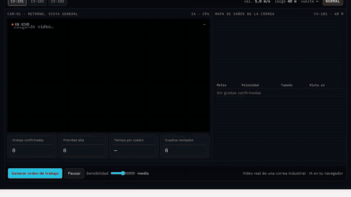
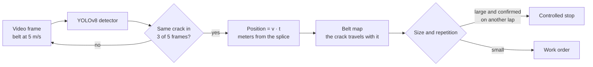

# Centinela · Conveyor Belt Sentinel

**A camera under the return side of a conveyor belt and an AI model on a local computer. It detects cracks while the belt runs, confirms each one over several frames, locates it in meters from the splice and creates the work order.**

[Español](README.md) · **English**

> The interface is in Spanish.

## The problem

A belt crack can turn into a longitudinal rip and days of downtime. Today it is found on foot patrols every few hours, with the belt running and poor light.

## How it works

- **Temporal confirmation.** A single detection raises nothing: the crack must appear in 3 of 5 consecutive frames.
- **Location.** Belt speed times the time since the splice passed gives the position in meters, which is what maintenance needs to find it.
- **Priority.** A stop is only requested if a large crack is confirmed on another lap; everything else becomes a work order.

## Results, with their limits

Tested on 9 held-out videos:

| Metric | Result |
|---|---|
| Videos with a correct alert | 6 of 9 |
| Alerts that were real cracks | 73 % |
| Chevron-pattern belts seen up close | no correct alert: almost absent from training |
| False alerts on healthy belt over hours | **not measurable** with this dataset: it only has cracked frames |

A real pilot trains on two to four weeks of the client's own belt video, including hours without damage, and sets the threshold with maintenance.

## Files

| File | What it is |
|---|---|
| `index.html` | Control room, try-your-own-photo mode and per-video results. |
| `det.js` | ONNX inference and post-processing. |
| `model.onnx.part0`, `.part1` | Detector weights split in two. |
| `f/a`, `f/b`, `f/c` | Frames of the three demo belts (CV-101, CV-102, CV-103). |
| `m/` | Sample frames for the photo test. |

## Licenses and credits

- Video and annotations: **BeltCrack** (Huang, Ji, Ma and Ye, 2026), *Pattern Recognition*, doi:[10.1016/j.patcog.2026.113598](https://doi.org/10.1016/j.patcog.2026.113598); dataset on Science Data Bank, doi:[10.57760/sciencedb.31181](https://doi.org/10.57760/sciencedb.31181), **CC BY-SA 4.0**. Frames here are downscaled and shared under the same license.
- **Ultralytics YOLOv8 (AGPL-3.0)** detector, so this repository's code is AGPL-3.0.

---

Personal project by **Julián Neira Nova**, electrical engineer with 10 years in mining operations · Servicio y Soluciones Tecnológicas DelaCruz SpA. Nothing here comes from clients or employers.
[Portfolio](https://jsnn15.github.io/) · [LinkedIn](https://www.linkedin.com/in/julian-neira-nova/) · [All tools](https://github.com/JSNN15)
