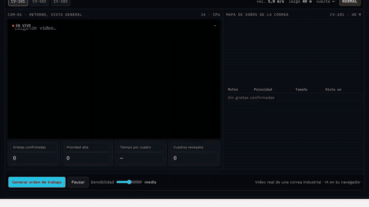
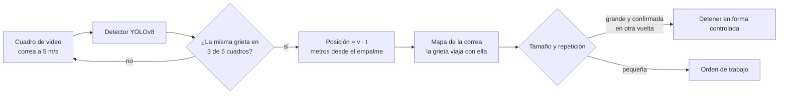

# Monitor de correas

**Una cámara bajo el retorno de una correa transportadora y un modelo de IA en un computador local. Detecta grietas con la correa en marcha, confirma cada una en varios cuadros, la ubica en metros desde el empalme y genera la orden de trabajo.**

**Español** · [English](README.en.md)

## El problema

Una grieta en la correa puede terminar en un corte longitudinal y días de detención. Hoy se busca con rondas a pie cada varias horas, con la correa en marcha y poca luz.

## Cómo funciona

- **Confirmación temporal.** Una detección aislada no genera aviso: la grieta debe aparecer en 3 de 5 cuadros seguidos.
- **Ubicación.** Con la velocidad de la correa y el tiempo desde que pasó el empalme se calcula la posición en metros, que es lo que necesita mantenimiento para encontrarla.
- **Prioridad.** La orden de detener solo sale si una grieta grande se confirma en otra vuelta; el resto va como orden de trabajo.

## Resultados, con sus límites

Probado con 9 videos de prueba que el modelo no vio:

| Medida | Resultado |
|---|---|
| Videos con aviso correcto | 6 de 9 |
| Avisos que eran grietas reales | 73 % |
| Correas con dibujo chevrón vistas de cerca | sin aviso correcto: casi no aparecen en el entrenamiento |
| Falsos avisos sobre correa sana durante horas | **no medible** con este conjunto: solo trae cuadros con grietas |

En un piloto real se entrena con dos a cuatro semanas de video de la correa del cliente, incluidas horas sin daño, y el umbral se fija junto a mantenimiento.

## Archivos

| Archivo | Qué es |
|---|---|
| `index.html` | Sala de control, prueba con foto propia o con la cámara en vivo (celular, tablet o PC) y resultados video por video. |
| `det.js` | Inferencia ONNX y posprocesamiento. |
| `model.onnx.part0`, `.part1` | Pesos del detector en dos partes. |
| `f/a`, `f/b`, `f/c` | Cuadros de las tres correas de la demo (CV-101, CV-102, CV-103). |
| `m/` | Cuadros de ejemplo para la prueba con foto. |

## Licencias y créditos

- Video y anotaciones: **BeltCrack** (Huang, Ji, Ma y Ye, 2026), *Pattern Recognition*, doi:[10.1016/j.patcog.2026.113598](https://doi.org/10.1016/j.patcog.2026.113598); dataset en Science Data Bank, doi:[10.57760/sciencedb.31181](https://doi.org/10.57760/sciencedb.31181), **CC BY-SA 4.0**. Los cuadros de este repositorio están reducidos y se publican bajo la misma licencia.
- Detector **Ultralytics YOLOv8 (AGPL-3.0)**; por eso el código de este repositorio es AGPL-3.0.

---

Proyecto personal de **Julián Neira Nova**, ingeniero eléctrico con 10 años en faena · Servicio y Soluciones Tecnológicas DelaCruz SpA. Nada de lo publicado proviene de clientes ni de empleadores.
[Portafolio](https://jsnn15.github.io/) · [LinkedIn](https://www.linkedin.com/in/julian-neira-nova/) · [Todas las máquinas](https://github.com/JSNN15)
